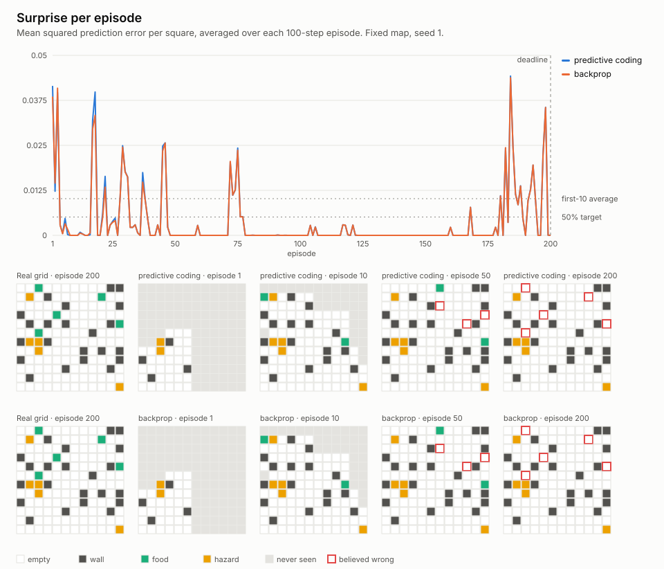

# Phase 1: does surprise drop?

Reproduce: `cargo run --release --bin surprise -- --out docs/p1`
(seed 1, default 12×12 layout, 200 episodes of 100 steps, rates 0.5 / 0.01).
The reflex baseline drives the body. The world model only watches and learns,
so any change in surprise comes from the model.

## Did surprise drop?

**Yes, and fast.** Mean surprise per square was 0.042 in episode 1. It was
below 0.001 by episode 5, and 137 of the 200 episodes are effectively zero
(under 1e-4). By episode 50 the apprentice had seen every square, and 98% of
its believed map was right.

What's left are spikes. Food regrows on a random empty square after each
meal, so the model is surprised when food appears where it remembers an empty
square, or is missing where it remembers food. A map of squares can't predict
that. The red-outlined squares in the episode-200 panels are exactly those:
food that has moved.

## Was the fallback triggered?

**Yes, by the rule as written.** I read "by episode 200" as the mean of
episodes 191–200, the same 10-episode window as the opening average. I fixed
that reading before the run.

| | first 10 episodes | episodes 191–200 | drop | rule |
|---|---|---|---|---|
| predictive coding | 0.0102 | 0.0110 | −7.8% | needs ≥ 50% → **triggered** |
| backprop baseline | 0.0102 | 0.0109 | −7.0% | (for comparison) |

There are two reasons it triggered even though learning clearly worked:

1. **Learning finishes inside the opening window.** Most of it happens in
   episodes 1–4, so the "before" average already includes a mostly learned
   model.
2. **The closing window caught a cluster of food spikes.** Episode 184
   peaked at 0.044. Over episodes 11–200 as a whole, surprise is 0.0033,
   which is 67% below the opening average.

## Backprop baseline

The baseline uses the same two layers. Each square's prediction is the prior
plus that square's own adjustment. It uses the same rates, world, seed and
inputs. Both layers are trained by the gradient of one global squared
sensory error, so the prior learns from the senses directly instead of from
layer 1.

| | below 0.001 by | mean, episodes 11–200 | map right at ep 50 / 200 |
|---|---|---|---|
| predictive coding | episode 5 | 0.0033 | 97.9% / 96.5% |
| backprop | episode 5 | 0.0032 | 97.9% / 96.5% |

**They are indistinguishable: same speed, same floor.** That is expected at
this depth. For a model this shallow, the local predictive-coding update and
the gradient are almost the same rule. They differ only in whether layer 2
learns from layer 1's state or from the raw senses. The main learner stays
predictive coding.

## What this means for later phases

- The 50% rule can't separate the two learners in this world. The model
  converges too fast, and the floor is set by random food. Better tests would
  be surprise on first visits only, shorter episodes, or adaptation time
  after walls are moved (the P3 test).
- The remaining surprise is the world changing, not the model failing to
  learn. The two levers are beliefs that know food is temporary (P4 decay)
  and acting to keep surprise down (P2).
