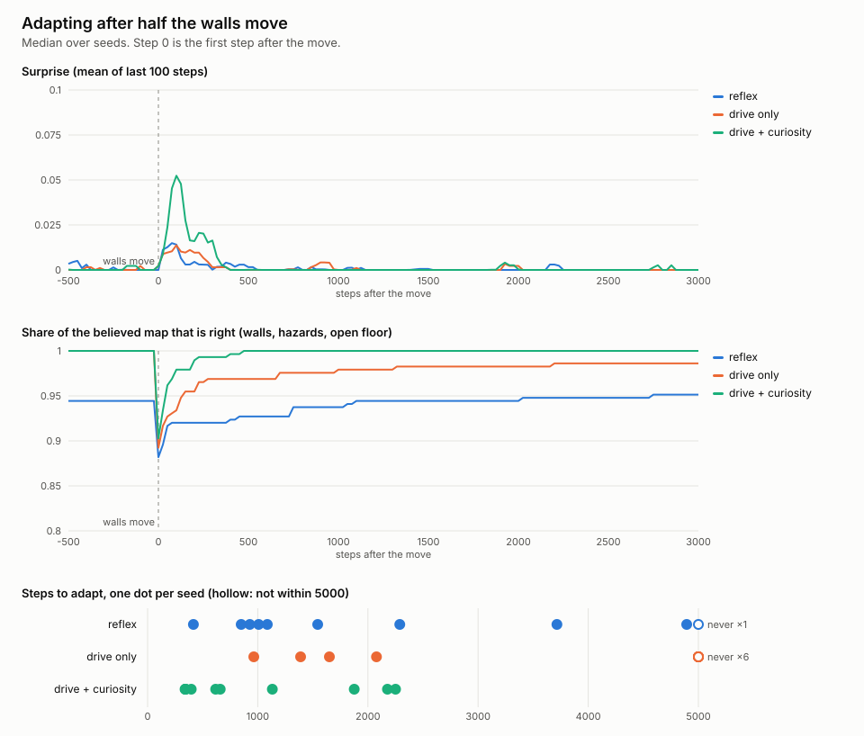

# Phase 2: does choosing its own actions help it adapt?

Reproduce: `cargo run --release --bin adapt -- --out docs/p2`
(seeds 1–10, default 12×12 layout, 3,000 warm-up steps, then half the walls
move, then 5,000 more steps). Per-seed numbers are in
[adaptation.csv](adaptation.csv).

## The apprentice

It acts only on things it has learned for itself, using delta rules and a
shortest-path search. There are no gradients and no ML library.

- **Where things are.** The phase 1 predictive-coding world model.
- **What things are worth.** The energy change it felt after stepping onto,
  or eating, each kind of square. It starts out neutral about moving and
  optimistic about eating, so it tries eating each kind of square until it
  learns which ones feed it.
- **How fast its world changes (volatility).** The error it finds when a
  square comes back into view, divided by how long it was away.

Every step, it scores each action against what it believes the map holds:

- **Drive.** Hunger grows below an energy setpoint of 80 and makes known
  food worth walking to.
- **Curiosity.** A bonus for squares it is unsure about, or hasn't looked at
  for a while, scaled by its learned volatility.
- **Path cost.** The cost of the route counts only energy beyond what
  resting would have cost anyway.

## The metric, fixed before the runs

Adaptation time is the number of steps after the move until two things hold
at the same time:

- **Surprise is back at its floor.** The mean over the last 100 steps (all
  after the move) is at most twice the mean of the 1,000 steps before the
  move.
- **The believed map is right again.** The share of squares whose believed
  wall, hazard or open floor matches reality is back to where it was just
  before the move. Food is counted as open floor, because food moves anyway.

The 100-step window means surprise can't recover in fewer than 100 steps.

## Results

| mind | median steps to adapt | adapted within 5,000 | meals | sleeps | mean energy |
|---|---|---|---|---|---|
| reflex (model only watches) | 1,316 | 9 / 10 | 32 | 302 | 26.8 |
| drive only | never (> 5,000) | 4 / 10 | 46 | 236 | 27.2 |
| **drive + curiosity** | **638** | **10 / 10** | **84** | **220** | **29.1** |

Meals, sleeps and mean energy are medians over the whole 8,000-step life.

- **Curiosity roughly halves adaptation time and never fails.** It adapts
  faster by going to look. Its surprise spike after the move is about three
  times taller, because it walks into the changes sooner, and it is back near
  zero within about 400 steps.
- **It also had the harder target.** Before the move, the curious apprentice
  had mapped 100% of the squares on every seed, so it had to get back to 100%.
  The reflex agent's pre-move map ranged from 70% to 100%, so its bar was
  often lower.
- **Drive alone maps well but doesn't re-check.** Hunting for food teaches it
  the whole map (100% on most seeds). Once it knows where food turns up, it
  stops looking around, and on 6 of 10 seeds it never re-mapped the moved
  walls.
- **It survives better, but survival isn't solved.** The curious apprentice
  eats 2.6 times as often as the reflex agent and sleeps 27% less. It still
  falls asleep about every 36 steps. With 5 food squares among 144, this
  world is short of food.

## What changed during the work

The first version barely ate: 0–6 meals in 8,000 steps. Three things were
wrong in the agent. The metric and the setup stayed the same throughout.

1. It never tried eating, because every kind of square started at zero
   value. Optimism about eating fixed that.
2. It counted the full energy cost of a route, which made anything more than
   about 5 squares away look worse than sitting still. A route now counts
   only the cost beyond resting.
3. Learned volatility collapsed to zero, because squares that never left
   view were counted as revisits. Now only squares that come back into view
   count, and volatility learns slowly (rate 0.01).

The other weights (curiosity 0.5, discount 0.9, horizon 20, setpoint 80)
were set before the first run and haven't been swept.

## Next

- **P3 dashboard.** Watch one apprentice live: real map against believed
  map, surprise and energy.
- **Open question.** It still sleeps often. A world with more food, or a
  learned sense of where food tends to regrow, would show whether that comes
  from the world or from the agent.
