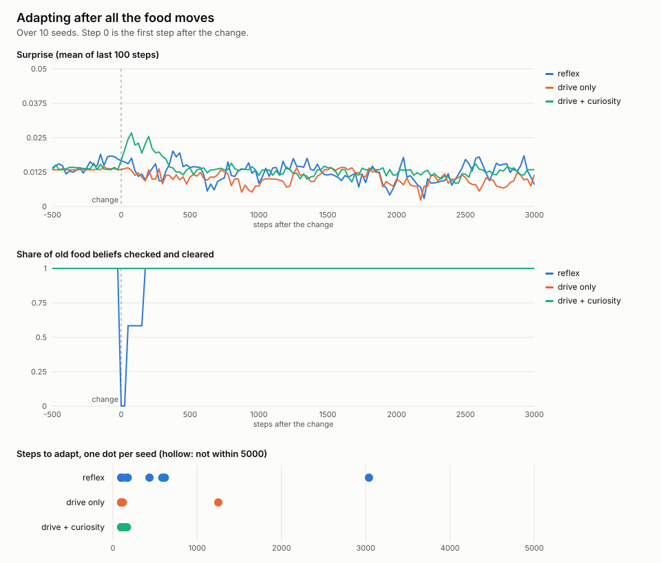

# Phase 3: belief dashboard and food that moves



Reproduce:

```sh
cargo run --release --bin adapt -- --change food --out docs/p3
cargo run --release --bin dashboard -- --out docs/p3/dashboard.html
```

Same setup as phase 2 (seeds 1–10, 12×12, 3,000 warm-up steps, then the
change, then 5,000 more steps), except that all the food moves instead of
the walls. Per-seed numbers are in [adaptation.csv](adaptation.csv).

## Dashboard

[dashboard.html](dashboard.html) is a self-contained replay of one life of
the curious apprentice (world seed 6, 4,500 steps): half the walls move at
step 1,500 and all the food moves at step 3,000. It shows the real grid next
to the believed grid, with every wrongly believed square outlined, plus
surprise, energy and the share of squares believed right over time. Play,
pause, scrub, or click the chart to jump. No libraries; the Rust binary
writes the data into an HTML template.

## Two changes to the world and the measure

**Food now grows back in place.** Until now, eaten food reappeared at once
on a random square, so food never had a place. "Moving the food" then
changes nothing the apprentice could have learned. The food test therefore
uses a new opt-in rule, `Regrowth::InPlace { delay: 30 }`: an eaten square
grows food again 30 steps later, like a bush. Moving the food moves every
bush, grown or regrowing, to squares that never held food. The default is
unchanged, so phases 0–2 reproduce exactly (re-run, same numbers).

**The food map measure was replaced before any result was reported.** The
first measure was "no phantom food believed, and at least one real food
square known". It held on only 0–25% of steps even before the move, so it
could not show adaptation. The measure used here is narrower and matches
what the move tests: of the food squares it believed in at the move, the
share it has since checked and stopped believing in. Adaptation still needs
surprise back at its floor as well, same rule as phase 2.

## Results

| Mind              | Median steps to adapt | Adapted  | Seeds with stale food beliefs | Median steps to first meal | Meals | Sleeps |
|-------------------|----------------------:|---------:|------------------------------:|---------------------------:|------:|-------:|
| reflex            | 170                   | 10/10    | 10/10                         | 38                         | 221   | 204    |
| drive only        | 100                   | 10/10    | 4/10                          | 14                         | 192   | 175    |
| drive + curiosity | 100                   | 10/10    | 3/10                          | 11                         | 248   | 158    |

100 steps is the floor of the measure (the surprise trail is 100 steps).
Meals and sleeps are medians over the whole 8,000-step life.

## What it means

- **Moving the food barely disturbs the apprentice, because it holds almost
  no beliefs about food.** It eats food as soon as it reaches it, and an
  eaten bush stays "empty" in its map until it happens to see it again. When
  the food moved, the curious apprentice believed in at most two food
  squares, and in 7 of 10 seeds in none. It found new food in a median of 11
  steps. The reflex agent holds more stale beliefs, because it sees food it
  doesn't walk to, and takes longer to clear them.
- **It does not learn where food grows.** Its world model stores what each
  square held when last seen, not that a square keeps producing food. That
  is a job for memory of past meals, which phase 4 (episodic diary and sleep
  replay) adds.
- **Bushes help it survive.** With food in fixed places the curious
  apprentice sleeps 158 times in 8,000 steps (one every 51 steps), against
  220 in the phase 2 world (one every 36).
- **A fed apprentice can stop exploring.** An exploratory run (not in the
  committed outputs) moved the walls in the bush world: the curious
  apprentice re-mapped them in 7 of 10 seeds, but in 3 it settled among its
  bushes and never re-checked the far side of the map. The dashboard shows
  one such life: after the walls move, the believed map stays near 88% right
  until the food moves at step 3,000 and hunger sends it searching.
