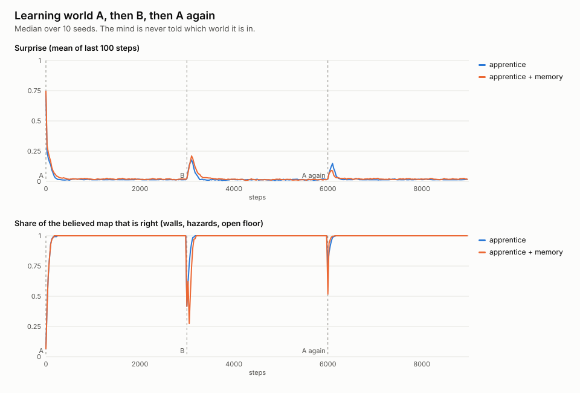

# Phase 4: diary, sleep replay, consolidation and decay



Reproduce:

```sh
cargo run --release --bin relearn -- --out docs/p4
cargo run --release --bin adapt -- --change walls --bushes --out docs/p4/walls-bushes
cargo run --release --bin adapt -- --change walls --out docs/p2
cargo run --release --bin adapt -- --change food --out docs/p3
```

Seeds 1–10. Per-seed numbers are in [relearn.csv](relearn.csv) and
[walls-bushes/adaptation.csv](walls-bushes/adaptation.csv). The phase 2 and 3
outputs were regenerated with the new mind added; their earlier rows are
unchanged.

## The memory

`memory::Memory` is a world model with two stores, as in the design sketch.

- **Diary (fast).** Every square it senses is written down in order, along
  with a fast belief per square that follows the latest sighting. Predictions
  come from the diary first.
- **Maps (slow).** There is one predictive-coding map per world it has lived
  in. A map changes only in sleep, when the diary is replayed into it at a low
  rate (0.2 per sighting). So the map holds how a square usually is, not how
  it was last seen. A bush it keeps eating from stays food in the map, even
  though it was last seen empty.
- **Consolidation and decay.** In sleep, each replayed sighting that matches
  the map makes that square stiffer. Squares the diary didn't rehearse fade
  toward the prior, and the stiffer a square, the slower it fades. A faded
  square becomes uncertain again, so curiosity sends the apprentice back to
  look at it.
- **Recognising a world.** Each map keeps a running average of its
  prediction error on what is being sensed now. When the active map stops
  fitting and another map fits, the apprentice switches back to that one. If
  no map has fitted for a while, it starts a new map. The new map keeps the old
  prior (what squares are usually like) but knows no particular squares. It
  is never told that the world changed.
- **Naps.** It sleeps when its energy runs out, and also takes a nap whenever
  the diary holds 64 steps. A nap is the same consolidation and costs no
  world time; that is a simplification.

Every update is still a local delta rule, with no gradients and no ML
library. The apprentice's planner, valence and volatility are unchanged
from phase 2; only the world model underneath is different.

## Rules fixed before running

1. **Coming back to A.** Each world is learned when the believed map
   reaches 95% of the accuracy it had at the end of the first A phase. The
   rule passes if, with memory, the second visit to A takes at most half as
   long as the first.
2. **Where food grows.** In the bush world, the apprentice with memory
   sleeps at least 20% less than the phase 3 apprentice.
3. **Exploring when fed.** In the bush world, it re-maps moved walls in at
   least 9 of 10 seeds. The phase 3 apprentice managed 7 of 10.
4. **No regression.** On the phase 2 wall test, median adaptation is no more
   than 25% slower than phase 2's 638 steps.

## Results

| Rule | Without memory | With memory | Met? |
|---|---|---|---|
| 1. Second A time / first A time (median) | 0.51 (58 / 102 steps) | **0.24** (28 / 108 steps) | yes |
| 2. Sleeps per 8,000 steps, bush world, food moves | 158 | 166 (+5%) | **no** |
| 2. Sleeps per 8,000 steps, bush world, walls move | 148 | 132 (−11%) | **no** |
| 3. Re-mapped moved walls, bush world | 7/10 | **10/10** | yes |
| 4. Phase 2 wall test, median steps to adapt | 638 | **390**, 10/10 | yes |

Also measured, though not part of any rule:

- **More meals and more energy everywhere.** Over 8,000 steps (median):
  - bush world, food moves: 276 meals vs 248, mean energy 34.8 vs 31.7
  - bush world, walls move: 337 meals vs 250, mean energy 39.6 vs 31.9
  - phase 2 world: 238 meals vs 84, mean energy 35.6 vs 29.1, sleeps 187 vs 220
- **It recognises the old world.** In every seed it made exactly two maps,
  one for A and one for B. In 9 of 10 it was using A's map at the end of the
  second visit to A.
- **Decay is what keeps it exploring.** These were exploratory runs, not
  committed outputs. With decay turned off, the fed apprentice re-mapped the
  moved walls in 7 of 10 seeds. With decay on, it re-mapped them in 10 of 10.

## What it means

- **Learning B no longer erases A.** B gets its own map, and A's map is
  recalled when A starts fitting again. Coming back, the apprentice gets A
  right in a median of 28 steps, a quarter of the first visit.
- **Without memory there is some savings too, from overlap.** The phase 3
  apprentice also relearns A in about half the time. Two random worlds agree
  on about 70% of squares, because both are mostly open floor, and B only
  overwrote the squares it visited. The
  memory halves that time again.
- **Recognition costs a little up front.** On the first step back in A, the
  apprentice with memory is still using B's map, which knows only B's
  squares. Its map is 52% right at that moment, against 76% for the
  apprentice without memory. A new world is learned more slowly for the same
  reason: B took a median of 146 steps against 104, because it keeps trusting
  A's map until a new one is started.
- **Where food grows: better fed, but not much less sleep.** The maps now
  hold bushes as food, so the apprentice eats more often and carries more
  energy, but it still runs out about as often. The rule was missed, and I
  did not retune anything after seeing the result. My best guess is that the
  same decay that keeps it exploring also spends the extra energy. That
  guess is untested.
